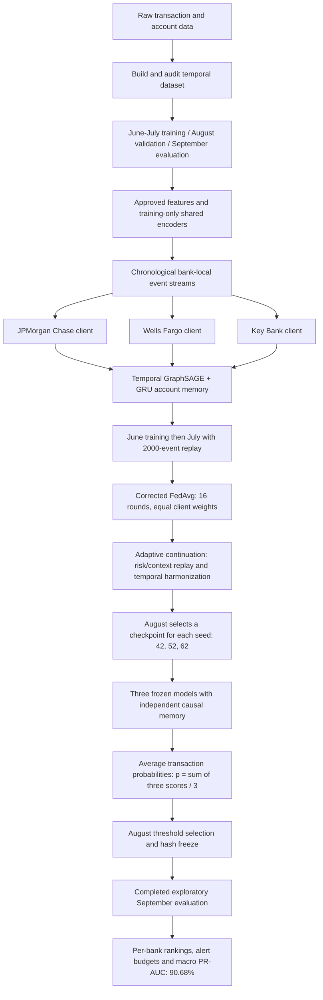

# Federated Continual Learning for AML Detection

This capstone evaluates privacy-preserving anti-money-laundering detection on a chronological, highly imbalanced transaction graph. The final pipeline progresses from a bank-local temporal GNN, to replay-based continual learning, to federated continual learning with FedAvg. PR-AUC is the primary metric; Recall@K and Precision@K measure performance under fixed analyst alert budgets.

## Latest progress: 90.68% PR-AUC

**The completed three-model ensemble achieves 90.68% September bank-macro PR-AUC (average precision), with 88.59% August validation PR-AUC.** Updated 27 October 2026; ensemble evaluation completed 23 October 2026.

| Progress milestone | September PR-AUC | Result type |
|---|---:|---|
| Local Temporal GNN | 44.2% ± 2.9 pp | Three-seed mean ± sample SD |
| Continual learning + replay | 58.1% ± 1.6 pp | Three-seed mean ± sample SD |
| Corrected FedAvg + local CL/replay | 75.9% ± 3.6 pp | Three-seed mean ± sample SD |
| Adaptive context replay + temporal harmonization | 87.10% ± 6.11 pp | Three-seed mean ± sample SD; exploratory |
| **Equal-probability ensemble of the three adaptive models** | **90.68%** | **One ensemble; exploratory** |

The ensemble averages probabilities from seeds **42, 52, and 62**, gaining **3.58 percentage points** over their individual-model mean. It needs three model passes and separate account-memory states. This is PR-AUC, not classification accuracy, and it does not exceed the best individual seed (93.16%). September was inspected in earlier work, so this is not an untouched-test generalization claim.

| Bank | Ensemble September PR-AUC |
|---|---:|
| JPMorgan Chase | 99.01% |
| Wells Fargo | 95.99% |
| Key Bank | 77.04% |
| **Equal-weight bank mean** | **90.68%** |

At **25 alerts per bank**, macro Precision@25 is **86.67%** and Recall@25 is **82.31%**. These fixed-budget ranking metrics do not establish a calibrated production alert policy.

Evidence: [saved ensemble metrics](artifacts/research_seed_ensemble/exploratory_september/metrics.json), [frozen validation record](artifacts/research_seed_ensemble/FREEZE.json), and [full results and limitations](docs/ENSEMBLE_IMPROVEMENT_RESULTS.md). See [final files to use](#final-files-to-use) and [the architectural flow](#end-to-end-architectural-flow) below.

## Original frozen results

| Frozen method | August validation PR-AUC | September PR-AUC |
|---|---:|---:|
| Local Temporal GNN | 0.404 ± 0.063 | 0.442 ± 0.029 |
| Continual Learning + replay | 0.599 ± 0.038 | 0.581 ± 0.016 |
| FedAvg + local CL/replay | **0.708 ± 0.094** | **0.759 ± 0.036** |

The corrected FedAvg pipeline was the strongest model in the original frozen evaluation. It improves September PR-AUC by 0.318 absolute (71.9% relative) over Local and by 0.178 absolute (30.5% relative) over CL. The earlier FedAvg result of 0.228 ± 0.035 is retained as a diagnostic negative result under `artifacts/historical/original_fedavg_final/`; it used a mismatched no-replay, sample-weighted procedure.

See [`docs/FINAL_EVALUATION_REPORT.md`](docs/FINAL_EVALUATION_REPORT.md) for the authoritative paper-ready results and limitations.

## Adaptive research update

A separate completed study adds risk and account-context replay plus temporal update harmonization. Across three seeds, the selected FCL method reaches **0.871 ± 0.061 September PR-AUC**, versus **0.787 ± 0.128** for matched FedAvg continuation. Standalone context-replay CL reaches **0.666 ± 0.060**, versus **0.534 ± 0.034** for its matched baseline. September was historically inspected, so these new results are **exploratory**; the original frozen results above remain preserved.

| Adaptive study method | August PR-AUC | September PR-AUC (exploratory) |
|---|---:|---:|
| Matched continual-learning baseline | 0.5214 ± 0.0552 | 0.5339 ± 0.0338 |
| **Risk and account-context replay CL** | **0.6326 ± 0.0446** | **0.6656 ± 0.0599** |
| Matched FedAvg continuation | 0.7673 ± 0.1216 | 0.7872 ± 0.1278 |
| **Context replay + temporal harmonization** | **0.8114 ± 0.1432** | **0.8710 ± 0.0611** |

Values are bank-macro means ± sample standard deviations across seeds 42, 52, and 62. The new federated model gains **11.2 percentage points** over historical FedAvg and **8.4 points** over its matched continuation control. Both new methods improve over their matched controls on all three seeds. Configuration and checkpoint selection used August only.

See [the completed results, ablations, and checkpoint paths](docs/ADAPTIVE_FCL_RESULTS.md) and [method definitions and prior work](docs/ADAPTIVE_FCL_RESEARCH.md). The new implementation is in the research simulator; it is not deployed through Kafka.

## October exploratory extension

A fixed equal-probability ensemble of the three existing adaptive models reaches
**90.68% September macro PR-AUC**, versus the **87.10% mean across its individual
members** (+3.58 percentage points). This is one three-member ensemble requiring
three model passes, not a new single-model or multi-seed result. September remains
exploratory. Ensembling is not claimed as novel. A separate experimental tail-risk
aggregation guard did not beat its matched continuation control and is retained
as a negative result. See [results and limitations](docs/ENSEMBLE_IMPROVEMENT_RESULTS.md).

A subsequent experimental pipeline adds **clock-preserving replay**: retain each
historical event's original memory-update group, control optimizer-step budgets,
and audit replay distortion against full causal history. It substantially reduces
reconstruction error in retained fraud events, but has not demonstrated a better
classifier. The default pipeline remains unchanged; this experimental candidate is not part
of the 90.68% ensemble.

## Cohort and temporal protocol

New modeling uses exactly three clients:

- JPMorgan Chase
- Wells Fargo
- Key Bank

Citi and Fifth Third Bancorp were excluded from new runs after historical development analysis. Their data and historical artifacts remain preserved for auditability.

| Split | Period | Purpose |
|---|---|---|
| Training | June–July 2025 | Learning and replay construction |
| Validation | August 2025 | Configuration, checkpoint, round, and threshold selection |
| Test | September 2025 | Original frozen evaluation; later extensions are exploratory |

The corrected temporal implementation processes transactions chronologically in batches of 1,024 and uses two-step truncated backpropagation through time (TBPTT). September data is not used for training or model selection.

## Original frozen architecture

1. `causal_temporal_graphsage.py`: bank-local causal Temporal GraphSAGE with GRU state.
2. `continual_temporal_graphsage.py`: the same model trained on June, then July with a 2,000-event replay buffer.
3. `federated_causal_temporal_graphsage.py`: three bank-local CL/replay clients, three local epochs per task, 16 FedAvg rounds, and equal client weights.

FedProx and superseded static/legacy runners are not part of the final pipeline. Exact immutable settings are in [`configs/final_pipeline.json`](configs/final_pipeline.json).

## Final files to use

For the **90.68% result**, use the saved adaptive checkpoints together with the ensemble evaluator. `configs/final_pipeline.json` defines the original baseline, not the full adaptive ensemble. Existing filenames are retained so checkpoint hashes and frozen evaluation references remain valid.

| Stage | File or directory | Purpose |
|---|---|---|
| Dataset preparation | [`scripts/build_final_temporal_dataset.py`](scripts/build_final_temporal_dataset.py) | Build the chronological dataset |
| Dataset audit | [`scripts/audit_final_temporal_dataset.py`](scripts/audit_final_temporal_dataset.py) | Check prepared data integrity |
| Model inputs | [`data/final_temporal_dataset/`](data/final_temporal_dataset/) | Split/bank folders with `transactions.csv.gz`, `ground_truth.csv.gz`, `edge_list.csv.gz`, `node_map.csv.gz`, and `node_features.csv.gz` |
| Approved features | [`configuration/model_feature_columns.json`](data/final_temporal_dataset/configuration/model_feature_columns.json) | Feature allowlists and exclusions; labels stay separate |
| Causal model and data loading | [`src/gnn/causal_temporal_graphsage.py`](src/gnn/causal_temporal_graphsage.py) | Training-only encoders, temporal GraphSAGE, GRU memory, scoring |
| Continual-learning baseline | [`src/gnn/continual_temporal_graphsage.py`](src/gnn/continual_temporal_graphsage.py) | June → July training with replay |
| Federated baseline | [`src/gnn/federated_causal_temporal_graphsage.py`](src/gnn/federated_causal_temporal_graphsage.py) | Corrected FedAvg warm-start models |
| Frozen baseline settings | [`configs/final_pipeline.json`](configs/final_pipeline.json) | Original Local / CL / FedAvg settings |
| Adaptive model training | [`src/gnn/adaptive_continual_federated.py`](src/gnn/adaptive_continual_federated.py) | Risk/account-context replay and temporal harmonization |
| Selected adaptive settings | [`configs/adaptive_fcl_warm_refined.json`](configs/adaptive_fcl_warm_refined.json) | `context_harmonized`: risk/context replay, temporal harmonization, no distillation |
| Adaptive study orchestration | [`scripts/run_adaptive_fcl_study.py`](scripts/run_adaptive_fcl_study.py) | Training/validation study runner; recorded commands are in the adaptive results report |
| Final ensemble entry point | [`scripts/evaluate_seed_ensemble.py`](scripts/evaluate_seed_ensemble.py) | Fixed probability averaging, validation freeze, explicit evaluation |
| Ensemble membership | [`artifacts/research_seed_ensemble/DESIGN.json`](artifacts/research_seed_ensemble/DESIGN.json) | Three members and equal-weight rule |
| Frozen selection evidence | [`artifacts/research_seed_ensemble/FREEZE.json`](artifacts/research_seed_ensemble/FREEZE.json) | Checkpoint/source hashes, data fingerprints, August thresholds |
| Final measured output | [`artifacts/research_seed_ensemble/exploratory_september/metrics.json`](artifacts/research_seed_ensemble/exploratory_september/metrics.json) | Saved 90.68% result and per-bank alert metrics |

**Use all three final checkpoint files:**

- [Seed 42 `global_model.pt`](artifacts/research_adaptive_fcl/warm_start/federated/context_harmonized/seed_42/global_model.pt)
- [Seed 52 `global_model.pt`](artifacts/research_adaptive_fcl/warm_start/federated/context_harmonized/seed_52/global_model.pt)
- [Seed 62 `global_model.pt`](artifacts/research_adaptive_fcl/warm_start/federated/context_harmonized/seed_62/global_model.pt)

There is no single merged ensemble checkpoint. Each member's directory also preserves its manifest, metrics and source snapshot. The [adaptive results report](docs/ADAPTIVE_FCL_RESULTS.md) documents the member training runs; the [ensemble report](docs/ENSEMBLE_IMPROVEMENT_RESULTS.md) documents final scoring. Historical/legacy runners, tail-guard experiments and clock-preserving replay are not required for this result. Kafka integration is not part of the evaluated ensemble.

## End-to-end architectural flow



1. **Prepare and encode.** Split chronologically, keep `y` in the ground-truth files, join labels by transaction ID, and map accounts consistently across splits. Shared feature encoders are fitted on training data only. The active clients are JPMorgan Chase, Wells Fargo and Key Bank.
2. **Score before updating memory.** Initialize account states from node features. For each chronological batch of 1,024 events, the decoder combines source state, destination state, their absolute difference and encoded transaction features. Sigmoid converts logits to transaction probabilities. Messages combine prior endpoint states, edge features and elapsed-time features; mean aggregation and a GRU update account memory only after the batch is scored. Thus events in one batch share the pre-batch state.
3. **Learn across time.** Local clients train on June, then July plus a 2,000-event historical replay buffer. Training uses a 128-dimensional hidden state and two-batch truncated backpropagation. The baseline prioritizes historical positives and samples negatives; the selected adaptive method adds risk/account-context replay.
4. **Collaborate across banks.** Corrected FedAvg uses equal client weights over 16 rounds, with three local epochs per task per round. The adaptive method starts from each seed's saved FedAvg checkpoint and allows four additional rounds. Temporal harmonization reduces conflicting updates in temporal model components; the selected variant uses no logit distillation. August macro PR-AUC selects checkpoints, with the initial checkpoint eligible. The implementation is a research simulator with shared preprocessing and central diagnostics, not a formally private deployed system.
5. **Ensemble frozen members.** Reconstruct each model's memory independently by streaming training history, then August, then September in chronological order without gradient updates. Average the three aligned probabilities for each transaction. Weights are fixed at one-third; bank thresholds are selected on August and recorded with hashes before September scoring.
6. **Report progress.** Compute average precision per bank and take the unweighted bank mean. Preserve PR-AUC, Precision@K, Recall@K and threshold metrics in the saved result. The completed September evaluation is exploratory; further model development needs a genuinely untouched later period.

## Repository layout

```text
configs/                   Frozen baseline and adaptive study configurations
data/final_temporal_dataset/
                           Chronological prepared data and data reports
src/gnn/                   Final model, training, and evaluation code
scripts/                   Dataset preparation and audit utilities
tests/                     Temporal-integrity and protocol regression tests
artifacts/final_evaluation/
                           Final Local, CL, and corrected-FedAvg results
artifacts/research_adaptive_fcl/
                           Adaptive models, including the three ensemble members
artifacts/research_seed_ensemble/
                           Fixed design, validation freeze and 90.68% result
artifacts/historical/      Preserved superseded experiments and diagnostics
docs/FINAL_EVALUATION_REPORT.md
                           Authoritative research report
docs/REPOSITORY_MANIFEST.md
                           File classification and reproducibility map
```

## Setup

Python 3.10 or newer is recommended.

```bash
python3 -m venv .venv
source .venv/bin/activate
python -m pip install -r requirements.txt
```

The final runnable pipeline depends only on NumPy, pandas, scikit-learn, and PyTorch. Historical static GraphSAGE code may require additional packages and is retained for audit, not as an active entry point.

## Reproducibility and safe use

Run protocol checks without training:

```bash
python -m unittest discover -s tests -v
python src/gnn/causal_temporal_graphsage.py --help
python src/gnn/continual_temporal_graphsage.py --help
python src/gnn/federated_causal_temporal_graphsage.py --help
```

The exact commands used for the completed runs are recorded in the final report. Do not rerun or tune against September as part of normal repository use. Any new research cycle should use validation-only development and a genuinely untouched later temporal holdout.

## Key documentation

- [`docs/FINAL_EVALUATION_REPORT.md`](docs/FINAL_EVALUATION_REPORT.md): final results, exact protocol, operational metrics, and scientific conclusion.
- [`docs/FEDAVG_COLLAPSE_INVESTIGATION.md`](docs/FEDAVG_COLLAPSE_INVESTIGATION.md): why the original FedAvg setup failed and how validation-only diagnosis corrected it.
- [`docs/PAPER_EVALUATION_PROTOCOL.md`](docs/PAPER_EVALUATION_PROTOCOL.md): evaluation policy and test-set safeguards.
- [`data/final_temporal_dataset/README.md`](data/final_temporal_dataset/README.md): prepared dataset layout and split details.
- [`docs/REPOSITORY_MANIFEST.md`](docs/REPOSITORY_MANIFEST.md): final versus historical file map.

## Scientific caveats

The data is simulated/experimental, client distributions are non-IID, only three institutions are active, and the cohort was selected post hoc from earlier development evidence. The corrected FedAvg result was selected strictly from August validation and scored once on September, but the project contains older September results; confirmation on a later untouched period is still required before making broad generalization claims.
